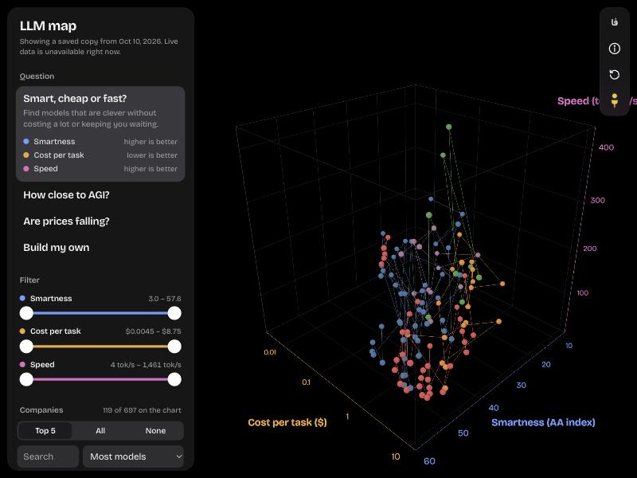

# LLM map

Every AI language model on one 3D chart. Each dot is a model, each line joins one company's models from oldest to newest, and the three axes are whatever you want to compare: smartness, cost, speed, price, ARC-AGI-2 score or release date.



## What you can do

- **Ask a question.** "Smart, cheap or fast?", "How close to AGI?" and "Are prices falling?" each set the three axes. "Build my own" lets you pick any three measures.
- **Open a model.** Click or tap a dot. The card sums the model up in one sentence, then ranks it against every other model on each measure with a coloured bar and a badge such as "Top 1%".
- **Read about a company.** A company card gives a short overview, a link to its website, its model count and its best model on each measure.
- **Filter by range.** Every axis has a two-handle slider, so you can keep only models under $1 per task or faster than 100 tokens a second. The chart refits to what is left.
- **Choose companies.** Tick them on and off, or pick Top 5, All or None. Search the list, or sort it by model count, name, newest model or best score.
- **Step inside the chart.** Drag the yellow figure onto a dot to stand beside that model, onto a line to ride through a company's history, or onto the floor to fly around.
- **Share the view.** The link in the address bar holds your question, filters, companies and Street View position, so whoever opens it sees exactly what you see.
- **Read it in Persian.** The language button switches the whole interface to Persian, laid out right to left, with Persian digits and the Solar Hijri calendar.
- **Install it.** It is a progressive web app with its own icon. After one visit it opens offline with the last data it saw.

A short tour introduces all of this on the first visit. The ⓘ button reopens it.

## Where the numbers come from

- [Artificial Analysis](https://artificialanalysis.ai/) supplies smartness (their Intelligence Index), cost per task, API price, output speed and release dates.
- The [ARC Prize leaderboard](https://arcprize.org/leaderboard) supplies ARC-AGI-2 scores. They are matched to Artificial Analysis models by name and effort setting. A model ARC has not tested has no score.

The Worker fetches both sources, merges them and caches the result for six hours. If the live request fails, the page falls back to the snapshot in `public/models.json` and says so.

## Run it locally

You need Node.js. Nothing else is installed: three.js and the fonts load from CDNs, and Wrangler runs through `npx`.

```bash
npx wrangler dev
```

Then open <http://localhost:8787>. Without an Artificial Analysis key the live endpoint returns 502 and the page uses the saved snapshot, which is enough for working on the interface.

To use live data, get a free key from Artificial Analysis and put it in `.dev.vars`, which git ignores:

```bash
echo 'AA_API_KEY=your-key' > .dev.vars
```

To try it on a phone on the same Wi‑Fi, run `npx wrangler dev --ip 0.0.0.0` and open the computer's local address on port 8787. The offline and install features only work over https or on localhost.

## Deploy

It runs on Cloudflare Workers. The Worker serves the files in `public/` and answers `/api/models`.

```bash
npx wrangler secret put AA_API_KEY
npx wrangler deploy
```

## Refresh the snapshot

`public/models.json` is the fallback data. To replace it with the current live data from a deployed Worker:

```bash
node scripts/snapshot.mjs https://your-worker.workers.dev
```

The script refuses to overwrite the file if the live data looks too thin.

## Tests

```bash
node --test test/
```

The tests cover the chart maths, the merge of the two data sources, the Worker, the company facts and sorting, the filter ranges, the bottom-sheet spring physics, and the translations: every English text has a Persian one with the same placeholders, and numbers, money and dates are written the Persian way.

## How it is built

No framework and no build step. The browser loads the modules in `public/` directly.

| File | What it does |
|---|---|
| `src/worker.js` | Fetches Artificial Analysis and ARC, caches the merged list, serves the static files |
| `src/merge.js` | Matches models between the two sources by name |
| `public/index.html` | The page, its styles, and the loading cover |
| `public/app.js` | Questions, filters, companies, the model and company cards, and the link |
| `public/scene.js` | The three.js chart |
| `public/space.js` | Chart maths with no DOM: scales, ticks, ranks, filters, link parts |
| `public/streetview.js`, `public/modes/` | Street View: standing, riding a line, flying |
| `public/i18n.js` | English and Persian text, number and date formatting, verdict sentences |
| `public/companies.js` | Company descriptions, websites and facts |
| `public/sheet.js`, `public/spring.js` | The phone bottom sheets and their spring motion |
| `public/tour.js` | The first-visit tour |
| `public/sw.js` | Offline support |
